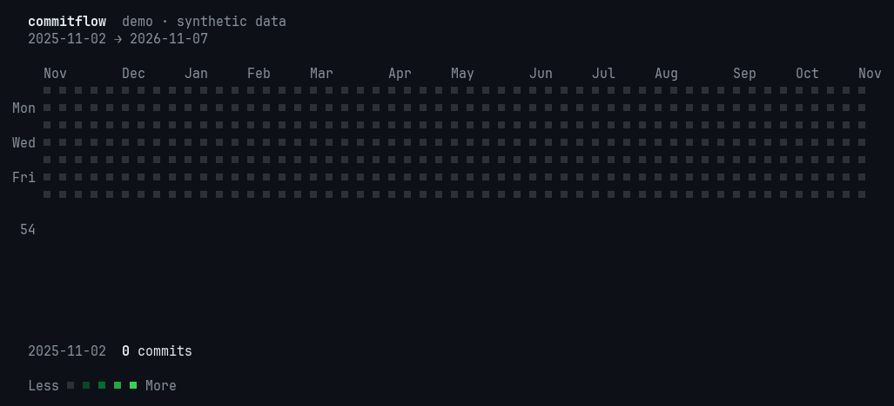

# commitflow

A terminal animation of a year of commits (GitHub + GitLab): a GitHub-style heatmap is revealed day by day while a weekly-volume bar chart grows underneath it, with a running counter and a summary at the end (active days, longest streak, busiest day).

Zig 0.17, no dependencies. Linux only (terminal size via `ioctl`).

## Demo



Try it without any account, network access or CLI tools: `--demo` animates a deterministic, synthetic year of commits.

```sh
zig build -Doptimize=ReleaseSafe
./zig-out/bin/commitflow --demo
```

The GIF above is a capture of exactly that command (`python3 scripts/make-demo-gif.py` regenerates it from the real binary; it needs Pillow and `script`). The animation is `--duration` seconds long, eased (slow start, fast middle, slow finish); the white cell is the day being revealed.

## Usage

```sh
zig build -Doptimize=ReleaseSafe
./zig-out/bin/commitflow                       # sources from the config file
./zig-out/bin/commitflow --github @me --gitlab gitlab.example.org/alice
./zig-out/bin/commitflow --static              # final frame only (also when stdout is not a TTY; `COLUMNS` then picks the width, e.g. `COLUMNS=80`)
```

Options: `--end YYYY-MM-DD`, `--duration SECONDS` (6), `--fps N` (30), `--no-color`, `--config PATH`, `--refresh`, `--no-cache`, `--demo`. `NO_COLOR` is honoured. Ctrl-C restores the cursor.

### Sources

Authentication is left to the already logged-in `gh` and `glab` CLIs; commitflow never touches tokens.

- `--github USER` — `@me` is the authenticated user.
- `--gitlab SPEC` — `USER` (gitlab.com), `HOST/USER` or `HOST/` (the authenticated user on HOST). Repeatable.

With no flags it reads `$XDG_CONFIG_HOME/commitflow/config` (or `~/.config/commitflow/config`); without a file it uses `--github @me`.

```
# ~/.config/commitflow/config
github = @me
gitlab = gitlab.example.org/alice
```

A source that fails (e.g. an internal GitLab while off the VPN; 25 s timeout) becomes a warning and the others carry on.

### Cache

Each account (GitHub or GitLab) gets a binary file in `$XDG_CACHE_HOME/commitflow/` (default `~/.cache/commitflow/`) with the per-day counts (36-byte header + 4 bytes per day, about 1.5 KB). On every run the program makes **one** cheap call and compares its result with what the cache holds:

| Source | Call | Compares | With cache | Without cache |
|---|---|---|---|---|
| GitLab | `users/:id/events?per_page=1` | newest push event id | ~0.2 s | ~15-20 s |
| GitHub | GraphQL `totalContributions` over the last 365 days | contribution total | ~0.6 s | ~1.9 s |

If they match, the cache is used. If not, a full fetch runs and the file is rewritten. A full fetch also happens when the cache is older than 7 days, does not cover the window, is corrupted, belongs to another account (the GitHub login is stored as a hash; for GitLab `@me` checks the user id) or `--refresh` is given. `--no-cache` disables both reading and writing.

Limits:

- GitLab: rebases, force-pushes and deleted branches produce no new push event; the 7-day TTL (or `--refresh`) covers that. A scan in which any project failed is not written.
- GitHub: the total only covers the last 365 days; a change in the first ~6 days of the 371-day window is only picked up by the TTL. Two changes that cancel out exactly in the total also go unnoticed.
- GitHub: a full fetch now makes the probe plus the two calendar calls, so a cold cache costs slightly more than it used to.

### What is counted

- **GitHub**: the contribution calendar (GraphQL `contributionCalendar`). GitHub exposes no commit-only daily series, so PRs, issues and reviews are included.
- **GitLab**: commits only. Push events discover the projects; each project is then listed and the user's commits are counted (by verified email or author name) on `authored_date`, merges excluded and each SHA once. `push_data.commit_count` is not usable: a "created branch" push carries the whole branch history (hundreds of commits).
- The window is 53 weeks ending today (local date), aligned to Sunday.

## Development

```sh
zig build test
```
